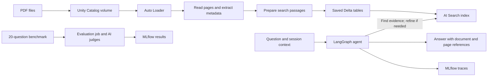

# How the solution works

The solution has two activities: preparing documents when you add files, and
answering questions when someone uses the app. Keeping these separate avoids
paying to read and prepare the same PDF every time someone asks a question.

## Preparing the PDFs

Upload PDFs into the solution's **volume**: a folder whose access is managed by
Unity Catalog. Run the ingestion job when you want new files to become searchable.

**Auto Loader** remembers the files already processed. The Lakeflow pipeline
then saves the output of each expensive AI step in Delta tables:

- `ai_parse_document` reads the PDF's pages and content.
- `ai_extract` produces a title, short summary and topics. The extraction schema
  can be changed for a customer's document types.
- `ai_prep_search` prepares passages for search. It keeps text intended for
  matching separate from text intended to be shown to the answer model.

The search text includes useful surrounding context; the answer uses the
retrievable passage. The pipeline retains original file paths and page references
so the app can show where the evidence came from. Processing errors remain
visible in saved tables. See [PDF pipeline](PIPELINE.md) for table names, data
fields, limitations and reprocessing instructions.

The final table, `document_chunks`, feeds a **Delta Sync AI Search index**. The
ingestion job refreshes that index after the pipeline finishes. Its embedding
model turns passages into numerical representations that help search find
similar meanings. The app uses hybrid search, which combines this with keyword
matching. A chunk is simply a passage, rather than an entire PDF.

## Answering a question

The Streamlit app hosts one small LangGraph flow:

1. Rewrite the question as a standalone search query. For a follow-up such as
   “How does that compare?”, use the recent conversation to resolve “that”.
2. Retrieve relevant passages and their document/page references.
3. Ask the model whether the passages provide enough evidence. If evidence is
   missing, refine the search and try again, up to three searches by default.
4. Write an answer when evidence is sufficient. Otherwise, explain that the
   supplied documents do not provide enough evidence.

The answer model returns individual claims and the IDs of their supporting
passages. Application code resolves those IDs and adds document/page citations.
An answer that references an unknown passage ID is rejected. This prevents
invented citation identifiers; it does **not** prove that every claim is supported
by the cited text. Groundedness evaluation and human review address that separate
question.

Page numbers refer to the PDF file's physical pages, counting the first page as
1. They can differ from page numbers printed inside a book. The app lets the
reader expand and read the exact retrieved passages used by the answer.

The graph and search count are bounded so the agent terminates. Empty search
results stop the flow with an insufficient-evidence message. Network/model
failures are shown as request errors, rather than disguised as factual answers.

## Models and compute

The bundle creates governed **Unity Gateway model services** for the agent and
evaluation judges. A model service is a stable, permission-controlled name that
routes requests to an underlying model. This lets the customer change the model
without rewriting the agent. The default routes use open-weight models.

The three built-in document AI functions choose their own platform-managed
models; changing the agent model does not change these functions. AI Search's
embedding endpoint is configured separately.

The document pipeline and job tasks use serverless compute. Databricks Apps,
AI Search and model services are managed services. Availability still depends on
the target workspace, region and supported runtime. In particular,
`ai_prep_search` must be verified in the chosen pipeline environment.

## Access and conversations

Authorized app users share one collection. Search and model requests use the
app's service identity, rather than each reader's individual data permissions.
Access to the app therefore grants access to answers from the shared collection.
Do not add documents that some app users must not see without first implementing
document-level access controls.

Conversation messages are held in each Streamlit session. They are not shared
between sessions and are not saved in a chat database. “Clear chat” removes that
session's conversation from the interface. It does not delete MLflow traces.
The latest 12 messages are passed to the model by default.

The Architecture tab links to the deployment's actual volume, tables, pipeline,
search index, jobs and MLflow experiment. The Unity Gateway service link opens
its containing Catalog Explorer schema; select the named model service there.
Opening these links requires the reader's own workspace permissions.

## Tracing and evaluation

MLflow records the agent flow, model requests/responses, retrieved passages and
timing. Traces are stored in a separate `<schema>_traces` Unity Catalog schema.
Keeping traces separate lets the app write tracing data while its document
collection remains read-only.

The evaluation job calls the same Python agent used by the app. It runs the
source-grounded benchmark, uses AI judges for semantic checks, and records
deterministic measures such as citation validity and latency. Results establish
a measured baseline, not a promise of production accuracy. Benchmark reference
answers are provided for customer review.

Questions, recent chat context and retrieved passages can contain sensitive
information and are included in traces. Review retention, access and redaction
before loading confidential material. The [hardening guide](HARDENING.md)
describes the production work intentionally left outside this reference.
